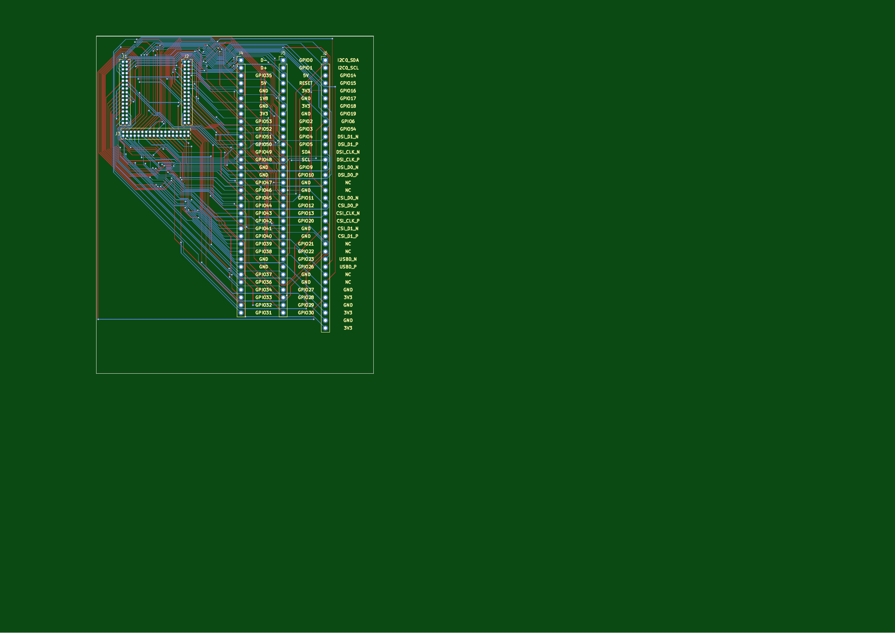

# ESP32-P4-Mini Interposer

A small break-out / **interposer** board for the **Spotpear (Waveshare-style) ESP32-P4-Mini development
board** (`ESP32P4-MINI-A`) that adapts its fine-pitch headers up to breadboard-friendly spacing.



## What the board is for

The ESP32-P4-Mini exposes its GPIO on **three dual-row 1.27 mm pin headers** — one on the **left edge (P1)**,
one on the **right edge (P2)**, and one along the **bottom edge (P3)**. 1.27 mm headers are too narrow and
fragile to plug directly into a standard solderless breadboard, which uses 2.54 mm spacing.

This interposer carries **three 1.27 mm female sockets laid out exactly where the Mini's headers are**, so
the Mini plugs down onto it level, and re-routes every one of the 104 pins to **three 2.54 mm single-row
male headers** for easy breadboard / jumper use.

```
       ┌────────────────────────────────────────────┐
       │   P1 (left, vertical)   ──►  J4 (2.54 mm)  │
  Mini │   P2 (right, vertical)  ──►  J5 (2.54 mm)  │
       │   P3 (bottom, horizontal)──► J6 (2.54 mm)  │
       └────────────────────────────────────────────┘
```

The board is a pure passive **1:1 passthrough** — each 1.27 mm input pin is routed straight to the
corresponding 2.54 mm output pin (no level shifting, no logic).

## Key facts

| | |
|---|---|
| Origin board | Spotpear `ESP32P4-MINI-A` — 23.4 × 31.25 mm, ESP32-P4 + ESP32-C6 |
| Input headers | P1 (left, 2×17), P2 (right, 2×17), P3 (bottom, 2×18) — all **1.27 mm** |
| Output headers | J4 (1×34), J5 (1×34), J6 (1×36) — all **2.54 mm** single-row |
| Total nets | 104, one per pin |
| Routing | 2-layer, Freerouting auto-routed; DRC clean (0 unconnected / 0 violations) |
| Silkscreen | Each 2.54 mm output pin labelled with its GPIO / signal name |
| Design | KiCad 10.0.6 (schematic + board) |

## Repository layout

```
.
├── kicad/                 KiCad design source and exports
│   ├── p4-mini-interposer.kicad_sch     schematic
│   ├── p4-mini-interposer.kicad_pcb     routed board
│   ├── p4-mini-interposer.kicad_pro     project
│   ├── p4-mini-interposer.pdf           schematic PDF
│   ├── p4-mini-interposer-routed.pdf    routed board PDF
│   ├── p4-mini-interposer-green.pdf     board render (green solder mask)
│   ├── p4-mini-interposer.ses           Freerouting session
│   └── p4-mini-interposer-bom.csv       bill of materials
├── reference/            Documents/source material the original board is built from
│   ├── esp32p4-mini.pdf   (Spotpear board schematic)
│   ├── esp32-p4-ext.pdf   (extension board schematic)
│   ├── esp32p4-mini.step / esp32p4-mini-2.step   (3D models)
│   └── *.jpg              (board photos)
└── docs/board-preview.png
```

> The files under `reference/` are the source documentation for the **Spotpear ESP32-P4-Mini** board and
> are the property of their respective authors (Spotpear / Waveshare); they are included for reference and
> are not covered by this project's license. The `kicad/` files are this interposer's own design.

## Silkscreen pinout

Each 2.54 mm output header pin is labelled with the function it connects to. Net mapping is a plain 1:1
passthrough, so output header **J4 pin N ↔ mini P1 pin N** (and likewise J5↔P2, J6↔P3):

| Output | Source header | Signals (by pin) |
|---|---|---|
| **J4** | **P1** (left, vertical) | D−, D+, GPIO31…53, 5V, 1V8, 3V3, GND |
| **J5** | **P2** (right, vertical) | GPIO0…30, SDA, SCL, RESET, 5V, 3V3, GND |
| **J6** | **P3** (bottom, horizontal) | I2C0_SDA/SCL, GPIO6/14–19/54, DSI±/CSI±, USBD±, 3V3, GND |

## Status

- Schematic **ERC clean** and board **DRC clean** (104/104 nets routed, 0 violations).
- Header positions on the interposer were derived from the Mini's 23.4 × 31.25 mm form factor and measured
  header spans (P1–P2 outer span 22.2 mm, P1 vertical span 20.7 mm, P3 span 21.9 mm, P3 set 1 mm off the
  bottom edge). **A physical fit-test against the actual board is recommended before fabrication.**

## License

This interposer design (the `kicad/` files and this README) is licensed under the MIT License — see
[LICENSE](LICENSE). Reference/vendor documents in `reference/` remain the property of their authors.
